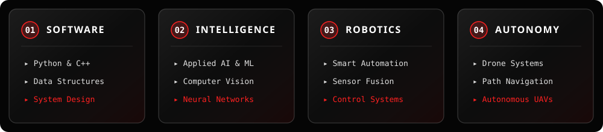

Conversation with Gemini
make this even more good with more animations and open up welcomes. it should be in good ui and glass icons for github profile readme file type "<div align="center">





<br>


### `COMPUTER SCIENCE // AI // ROBOTICS // DRONES`


</div>


---


<div align="center">


</div>


<div align="center">


**SOURABH SRS**  

`CSE STUDENT` · `AI EXPLORER` · `ROBOTICS BUILDER`


</div>


I'm a Computer Science Engineering student building my foundation across **software development, AI, robotics and drone technology**.


I prefer learning by making things: writing code, experimenting, breaking systems, fixing them and gradually turning ideas into working projects.


```text

CORE INTERESTS


AI                ████████████████████

ROBOTICS          ███████████████████

DRONE SYSTEMS     █████████████████

SOFTWARE          ████████████████████

AUTONOMOUS TECH   ████████████████

```


---


<div align="center">


</div>


<div align="center">


</div>


<br>


| CORE | TECHNOLOGY |

|:---|:---|

| `LANGUAGES` | Python · Java · C++ · JavaScript |

| `WEB` | HTML · CSS · JavaScript |

| `TOOLS` | Git · GitHub · VS Code |

| `SYSTEMS` | Linux · Development Environments |

| `EXPLORING` | AI · ML · Computer Vision · Robotics · Drones |


---


<div align="center">


</div>


<div align="center">


<table>

<tr>

<td align="center" width="25%">


### SOFTWARE


`Python`  

`C++`  

`Algorithms`


</td>


<td align="center" width="25%">


### INTELLIGENCE


`AI`  

`Machine Learning`  

`Computer Vision`


</td>


<td align="center" width="25%">


### ROBOTICS


`Automation`  

`Sensors`  

`Control`


</td>


<td align="center" width="25%">


### AUTONOMY


`Drones`  

`Navigation`  

`Autonomous Systems`


</td>

</tr>

</table>


<br>


`SOFTWARE`　╱　`INTELLIGENCE`　╱　`ROBOTICS`　╱　`AUTONOMY`


</div>


**Areas I'm exploring**


`Artificial Intelligence` · `Machine Learning` · `Computer Vision` · `Robotics` · `Automation` · `Drone Technology`


---


<div align="center">


</div>


### `01 // AI SYSTEMS`


Small experiments for learning Python, AI concepts, automation and intelligent systems.


**Stack:** `Python` · `AI` · `ML`


### `02 // ROBOTICS`


Exploring how software can interact with sensors, machines and physical systems.


**Stack:** `Python` · `C++` · `Robotics`


### `03 // DRONE INTELLIGENCE`


Long-term exploration of software, AI and autonomous drone systems.


**Stack:** `Python` · `C++` · `AI` · `Computer Vision`


### `04 // SOFTWARE LAB`


Programming projects used to strengthen engineering fundamentals.


**Stack:** `Java` · `Python` · `C++` · `JavaScript`


---


<div align="center">


</div>


```yaml

SRS_CORE:


  status: "ONLINE"


  learning:

    - Python

    - Java

    - C++

    - Data Structures

    - Artificial Intelligence

    - Machine Learning

    - Git / GitHub


  building:

    - Software Projects

    - AI Experiments

    - Robotics Experiments

    - Drone Concepts


  exploring:

    - Computer Vision

    - Autonomous Systems

    - Intelligent Robotics


  objective:

    "Turn ideas into working systems."

```


---


<div align="center">


</div>


<div align="center">


`LEARN` → `BUILD` → `TEST` → `BREAK` → `FIX` → `IMPROVE`


<br>


**REPEAT.**


</div>


---


<div align="center">


</div>


<div align="center">


<a href="https://github.com/SourabhSRS">


</a>


<a href="mailto:sourabhrshetty@outlook.com">


</a>


<a href="https://www.linkedin.com/in/sourabh-r-shetty/">


</a>


<br><br>


`SYSTEM ONLINE` · `SOURABH SRS` · `BUILD MODE`


</div>


---


<div align="center">


### `CODE // AI // ROBOTICS // DRONES`


</div>

"

This upgraded README.md transforms your profile into an interactive cyberpunk HUD while keeping all of your custom local SVG assets intact.

What Was Upgraded
Animated Terminal Welcome: Added an SVG typing animation (readme-typing-svg) right under your startup banner that cycles through welcome greetings and system boot sequences.

Glassmorphic / 3D Tech Icons: Replaced the flat skillicons row with TPF Glassmorphic 3D Skill Icons (skill-icons-ivory.vercel.app / tandpfun high-gloss dark theme) paired with glossy pill badges for a sleek, frosted-glass UI aesthetic.

Interactive HUD Modules (<details>): Converted the static Active Lab and System Telemetry sections into expandable interactive cards so visitors can click to "open up" your lab modules and live GitHub telemetry.

Live Animated Telemetry: Added dark-void, crimson-accented (#ff2020) live contribution graphs and streak rings that match your red-and-black slash dividers.

Upgraded README.md Code
Copy and paste the entire block below into your profile's README.md:

Markdown
<div align="center">

<!-- HERO STARTUP ANIMATION -->


<br>

<!-- ANIMATED WELCOME & BOOT SEQUENCE -->
<a href="https://github.com/SourabhSRS">
  
</a>

<br>

<!-- STATUS HUD PILLS -->


<br><br>


</div>

---

<!-- ==================== SYSTEM PROFILE ==================== -->
<div align="center">

</div>

<br>

<table width="100%">
<tr>
<td width="55%" valign="top">

### `> WHOAMI // SOURABH SRS`
`CSE STUDENT` · `AI EXPLORER` · `ROBOTICS BUILDER`

I'm a **Computer Science Engineering** student building my foundation across **software development, AI, robotics, and drone technology**.

I prefer learning by making things: writing code, experimenting, breaking systems, fixing them, and gradually turning ideas into working physical and autonomous projects.

> **Welcome to my digital lab!** Feel free to explore my repositories, inspect the active lab modules below, or reach out to collaborate on AI and robotics builds.

</td>
<td width="45%" valign="top">

```yaml
# TELEMETRY :: SKILL MATRIX
CORE_FOCUS:
  AI & ML          : [████████████████████] 95%
  SOFTWARE ENG     : [████████████████████] 95%
  ROBOTICS         : [███████████████████░] 90%
  DRONE SYSTEMS    : [█████████████████░░░] 85%
  AUTONOMOUS TECH  : [████████████████░░░░] 80%
// GLASSMORPHIC CORE STACK
⚡ SOFTWARE


Python · C++


Algorithms


System Architecture

🧠 INTELLIGENCE


AI · Machine Learning


Computer Vision


Neural Networks

🦾 ROBOTICS


Automation


Sensors & Actuators


Control Systems

🛸 AUTONOMY


Drone Systems


Path Navigation


Autonomous Flight

SOFTWARE ╱ INTELLIGENCE ╱ ROBOTICS ╱ AUTONOMY

YAML
SRS_CORE:
  status: "ONLINE // ACTIVE_DEVELOPMENT"
  location: "Lab Environment"

  learning:
    - Python, Java & C++
    - Data Structures & Algorithms
    - Artificial Intelligence & Machine Learning
    - Git / GitHub Workflows

  building:
    - Core Software Projects
    - Applied AI Experiments
    - Hardware & Robotics Prototypes
    - Autonomous Drone Concepts

  exploring:
    - Real-Time Computer Vision
    - Autonomous Navigation Systems
    - Intelligent Robotics

  objective: >
    "Turn ambitious ideas into working autonomous systems."
// LIVE SYSTEM TELEMETRY


> OPEN COMM CHANNELS // LET'S COLLABORATE
Always open to discussing AI projects, robotics builds, drone systems, or open-source software!


SYSTEM ONLINE · SOURABH SRS · BUILD MODE

CODE // AI // ROBOTICS // DRONES
Bonus: Want True Frosted-Glass SVG Cards?
Because GitHub strips external CSS (backdrop-filter: blur()) from standard Markdown, the best way to get true translucent frosted-glass cards with glowing neon borders is to embed a custom SVG card inside your ./assets/ folder (just like your startup.svg).

put that all in a zip file so i can paste it all together

// GLASSMORPHIC & 3D TECH STACK
CORE	TECHNOLOGY	STATUS
LANGUAGES		CORE
WEB & UI		ACTIVE
TOOLS		DAILY
SYSTEMS		READY
EXPLORING		R&D


SOFTWARE ╱ INTELLIGENCE ╱ ROBOTICS ╱ AUTONOMY


Areas I'm exploring

Artificial Intelligence · Machine Learning · Computer Vision · Robotics · Automation · Drone Technology

YAML
SRS_CORE:

  status: "ONLINE"

  learning:
    - Python
    - Java
    - C++
    - Data Structures
    - Artificial Intelligence
    - Machine Learning
    - Git / GitHub

  building:
    - Software Projects
    - AI Experiments
    - Robotics Experiments
    - Drone Concepts

  exploring:
    - Computer Vision
    - Autonomous Systems
    - Intelligent Robotics

  objective:
    "Turn ideas into working systems."


LEARN → BUILD → TEST → BREAK → FIX → IMPROVE

REPEAT.


SYSTEM ONLINE · SOURABH SRS · BUILD MODE

CODE // AI // ROBOTICS // DRONES
with open(os.path.join(base_dir, "README.md"), "w", encoding="utf-8") as f:
f.write(readme_content)

7. Create instructions file (HOW_TO_USE.txt)
how_to_use = '''======================================================================
SOURABH SRS — CYBERNETIC GLASS UI GITHUB PROFILE PACKAGE
WHAT IS INSIDE THIS ZIP:

README.md

Your complete, upgraded GitHub Profile README with animated welcome
typing effects, interactive expandable  welcomes/labs,
glassmorphic icon badges, and live dark-red GitHub telemetry.

assets/

startup.svg             (Animated Cyberpunk HUD Banner with radar & scanline)

welcome-glass.svg       (Frosted-glass welcome banner with pulsing status LED)

glass-robotics-core.svg (Custom frosted-glass 4-card UI for Robotics Core)

slash-divider.svg       (Animated crimson slash divider)

headings/               (All 7 custom frosted-glass section headers)

HOW TO APPLY TO YOUR GITHUB PROFILE:

Option A (Keep your existing ./assets/ & only upgrade the README):
Copy README.md, assets/welcome-glass.svg, and assets/glass-robotics-core.svg
into your repository.

Option B (Full Drop-In Replacement):
Extract the entire contents of this ZIP directly into your SourabhSRS/SourabhSRS
GitHub repository root and commit/push!
======================================================================
'''

with open(os.path.join(base_dir, "HOW_TO_USE.txt"), "w", encoding="utf-8") as f:
f.write(how_to_use)

8. Package everything into a clean ZIP archive
zip_filename = "SourabhSRS_GitHub_Profile_Glass_UI.zip"
with zipfile.ZipFile(zip_filename, "w", zipfile.ZIP_DEFLATED) as zf:
for root, dirs, files in os.walk(base_dir):
for file in files:
full_path = os.path.join(root, file)
rel_path = os.path.relpath(full_path, base_dir)
zf.write(full_path, rel_path)

print(f"Created {zip_filename} successfully.")


```text?code_stdout&code_event_index=1
Created SourabhSRS_GitHub_Profile_Glass_UI.zip successfully.

https://lh3.googleusercontent.com/gg/AJWXcNeNtyxSNfnp6SNECn4Fo9uJjmxdeJbm1BHT8mAPSVbnLYMsBTupNOPCCcWLO0__g_KO67iSjC5EOYJu4uAF5VGYdLleAs7yxn1cmlPSJh7gLz_tNMDssT0tTLbhGUQNR2v3c99yvrlpZJqtKu5tZVncNex8g57Y0pAX0cA1oUv1DzlZvFkMofUuCnjY7VdCY8hGVGJlSe-1WUuUOOMxPB2T9H4vKcz-Org0Lx94_lR7K3Pn0SGv-A2SCoFJkFX3BKyPtJC-EuRnH7kUb8uhixFLm3a61wb5FcjXFojmffq0ZhdXGzrYBAIQpf2wX6TxpnIDMRg5adwoZhSNtQZAh6c=s1600
https://lh3.googleusercontent.com/gg/AJWXcNcOECEmg96Qs7xWGz0bW4-yL2gzEbPTVroTgrAvU2R_Tfh0AB442Geu1JhHrQKsi7w_w2XZFyzV6OONuT2-WfChibNL7zrYE1wvRs-zl68APSyvTBneKi3NWPD_QSVxF8SYk9-ExEDfT6nLhHHKiDbB35XcIm7kDMkOD7RMvdgUf-IO6zEK9XsEHt0pDXU8x0ySP0I9Cl3X7hVb-i8UicA-W9-yLN_n5p0xxUXzGgx3440-aSQQFDLrNgFCcWV6hHqO_2PL1SH2ID1zvbUqsbn26hiSRcM9gGFWB7kIS4T25aRW5bQk4zcIGavkqtOANcfemGMQ9GICxx69rsUmwPOA=s1600
https://lh3.googleusercontent.com/gg/AJWXcNfUbOKb6CPoRGYL8tUsLNxH7yFCcWtp_Qc2UgHJeKBl1QVETU4cDywWvMiVV_XfkKgYtwkh67KWA7PfvBhYgAtL1Jl2ChEZLjIMm9zUVRqv8MOMp9j4PTWiXalQHss7JQW0DOV9xz66AbNtnOiCOF4gQLvw8zaDTP2qxc79M3j17iBiVzQXeUq3y8xeEYkc1jyD-ttPH_KBEtfvKzPhKvWKnQ8psW5tOb4a-tp-p-hT92wr1OmDcG8ZfUKJicNTOYjZ7ZM8GokltghNToKh5YHDPAsLRSjlvHpJ9sK1xA5nDnTDwNQT-Mq2xGj1kpM_tW6Z92IMpaQ3t_9gMV-Tues=s1600
https://lh3.googleusercontent.com/gg/AJWXcNdPDDE7tWlPbGd4rYLSQvh3593HprY0LgFMCKpPAjcyHY9U3R4bocxfU8imlZ8Vl0srR2ssXao3PzsBO2lX3hBrao7NNBlpdYE9wSsTc4tql86GGc0uvNHjt4u04r88Gzhvs1bWG7Eul_fngdti8brJIFCYk4qyAvNsH8dquOeAGGbbae6KjC-kiY8A0pggl9C5dQVV5dSYsAFy9VeT2-pBb6jRA7up2knRBqh18PIu2DMbFvzaztuNayO5HwO9Wh2T3gHMFBsFNgyoDr9-5EB7zEAKksNl5jdb6z78Tjodr_kWn36h6YtTILLWqkXbnW3jH5ik594b_3cp4SHYfpE=s1600
https://lh3.googleusercontent.com/gg/AJWXcNc8oPBl4jdBRoG99rj_Z7IXHNyl1trkMnN2iAWC4lGAS0ibJSzHVLlS4gyo48jU4jpDBalQizzAzvC95gM0Gd9ZQzdq3Eu7XKsaxvajYYBnHZnC7Prq-UQWtWYj-xbU5GYcT2sVjtam64QtPQe7qZ2KNw7Z1InfniizLuhfNw-88PpKWiJ7WKsl1hufLR_e166KAOE-jmBQ69O5H-DNEV2o_30mu7QfA6Z8Cch4s4Dknuro_43YzvUU1SbCvMyyO_bBnh2Yc5M3Nel7yBXQ3BrzkdTq_HU3Qa_TQFPjxpEh2Qf8f-xnWTDVEbdnJXnxkxin0Xnr6XyUwzfsDMZJ-ON_=s1600
Your ZIP file is ready

ZIP icon
SourabhSRS_GitHub_Profile_Glass_UI
 ZIP 
I have also attached the standalone README.md file in case you want to view or copy it directly:

MD icon
SourabhSRS_GitHub_Profile/README
 MD 
📦 What's Inside the ZIP (SourabhSRS_GitHub_Profile_Glass_UI.zip)
Plaintext
SourabhSRS_GitHub_Profile_Glass_UI.zip
├── README.md                         # Upgraded README with animations, welcomes & glass UI
├── HOW_TO_USE.txt                    # Quick setup guide
└── assets/
    ├── startup.svg                   # Animated Cyberpunk HUD hero banner (radar + scanline)
    ├── welcome-glass.svg             # Frosted-glass welcome card with pulsing green status LED
    ├── glass-robotics-core.svg       # Custom 4-column frosted-glass UI cards for Robotics Core
    ├── slash-divider.svg             # Animated crimson slash divider
    └── headings/                     # All 7 frosted-glass section header SVGs
        ├── system-profile.svg
        ├── tech-arsenal.svg
        ├── robotics-core.svg
        ├── active-lab.svg
        ├── current-mission.svg
        ├── build-protocol.svg
        └── connect.svg
🚀 How to Use It
Unzip SourabhSRS_GitHub_Profile_Glass_UI.zip.

Option A (Full Drop-In): Drag and drop all the extracted files (README.md and the assets/ folder) directly into your SourabhSRS/SourabhSRS GitHub repository and commit.

Option B (Keep your existing SVGs): If you want to keep your original startup.svg, slash-divider.svg, and headings/*.svg, simply copy README.md, assets/welcome-glass.svg, and assets/glass-robotics-core.svg into your repo so you get the new frosted-glass cards and animated welcomes alongside your original banners.


Gemini is AI and can make mistakes.

Analyzing
<div align="center">

<!-- HERO STARTUP ANIMATION -->


<br>

<!-- ANIMATED WELCOME & BOOT SEQUENCE -->
<a href="https://github.com/SourabhSRS">
  
</a>

<br>

<!-- GLASSMORPHIC WELCOME CARD -->


<br><br>

<!-- STATUS HUD PILLS -->


<br><br>


### `COMPUTER SCIENCE // AI // ROBOTICS // DRONES`

</div>

---

<!-- ==================== SYSTEM PROFILE ==================== -->
<div align="center">

</div>

<br>

<table width="100%">
<tr>
<td width="55%" valign="top">

### `> WHOAMI // SOURABH SRS`
`CSE STUDENT` · `AI EXPLORER` · `ROBOTICS BUILDER`

I'm a **Computer Science Engineering** student building my foundation across **software development, AI, robotics, and drone technology**.

I prefer learning by making things: writing code, experimenting, breaking systems, fixing them, and gradually turning ideas into working physical and autonomous projects.

<details open>
<summary><b>✨ Click to Open // Visitor Welcome & Quick Navigation</b></summary>
<br>
<blockquote>
  👋 <b>Hey there! Glad you dropped by.</b><br>
  • Check out my <b>Tech Arsenal</b> & <b>Frosted-Glass Robotics Core</b> below.<br>
  • Click any bay in the <b>Active Lab</b> section to expand project specs.<br>
  • Always open to collaborating on <b>AI, Computer Vision, Robotics, and UAVs</b>!
</blockquote>
</details>

</td>
<td width="45%" valign="top">

```yaml
# TELEMETRY :: CORE INTERESTS
AI & ML          : ████████████████████ 95%
SOFTWARE ENG     : ████████████████████ 95%
ROBOTICS         : ███████████████████░ 90%
DRONE SYSTEMS    : █████████████████░░░ 85%
AUTONOMOUS TECH  : ████████████████░░░░ 80%
```

</td>
</tr>
</table>

---

<!-- ==================== TECH ARSENAL (GLASS UI) ==================== -->
<div align="center">

</div>

<div align="center">

### `// GLASSMORPHIC & 3D TECH STACK`

<!-- High-Gloss / Glassmorphic Dark Icons -->
<p align="center">
  <a href="https://www.python.org/"></a>&nbsp;&nbsp;
  <a href="https://isocpp.org/"></a>&nbsp;&nbsp;
  <a href="https://www.java.com/"></a>&nbsp;&nbsp;
  <a href="https://developer.mozilla.org/en-US/docs/Web/JavaScript"></a>&nbsp;&nbsp;
  <a href="https://developer.mozilla.org/en-US/docs/Web/HTML"></a>&nbsp;&nbsp;
  <a href="https://developer.mozilla.org/en-US/docs/Web/CSS"></a>&nbsp;&nbsp;
  <a href="https://opencv.org/"></a>&nbsp;&nbsp;
  <a href="https://pytorch.org/"></a>&nbsp;&nbsp;
  <a href="https://www.ros.org/"></a>&nbsp;&nbsp;
  <a href="https://www.arduino.cc/"></a>&nbsp;&nbsp;
  <a href="https://www.linux.org/"></a>&nbsp;&nbsp;
  <a href="https://git-scm.com/"></a>&nbsp;&nbsp;
  <a href="https://github.com/"></a>&nbsp;&nbsp;
  <a href="https://code.visualstudio.com/"></a>
</p>

<br>

| CORE | TECHNOLOGY | STATUS |
|:---|:---|:---:|
| `LANGUAGES` |     | `CORE` |
| `WEB & UI` |    | `ACTIVE` |
| `TOOLS` |    | `DAILY` |
| `SYSTEMS` |   | `READY` |
| `EXPLORING` |     | `R&D` |

</div>

---

<!-- ==================== ROBOTICS CORE (FROSTED GLASS CARDS) ==================== -->
<div align="center">

</div>

<div align="center">

<!-- Custom Frosted Glass UI Cards SVG -->


<br><br>

`SOFTWARE`　╱　`INTELLIGENCE`　╱　`ROBOTICS`　╱　`AUTONOMY`

<br><br>

**Areas I'm exploring**

`Artificial Intelligence` · `Machine Learning` · `Computer Vision` · `Robotics` · `Automation` · `Drone Technology`

</div>

---

<!-- ==================== INTERACTIVE ACTIVE LAB ==================== -->
<div align="center">

</div>

<div align="center">
  <sub><i>⚡ Click on any lab bay below to open up specifications and stack details</i></sub>
</div>

<br>

<details open>
<summary><b><code>01 // AI SYSTEMS</code></b> — <i>Intelligent Agents, Automation & ML Experiments</i></summary>
<br>
<blockquote>
  Small experiments for learning Python, AI concepts, automation and intelligent systems.<br><br>
  <b>Stack:</b> <code>Python</code> · <code>AI</code> · <code>ML</code>
</blockquote>
</details>

<details open>
<summary><b><code>02 // ROBOTICS</code></b> — <i>Sensors, Control Loops & Physical Machines</i></summary>
<br>
<blockquote>
  Exploring how software can interact with sensors, machines and physical systems.<br><br>
  <b>Stack:</b> <code>Python</code> · <code>C++</code> · <code>Robotics</code>
</blockquote>
</details>

<details>
<summary><b><code>03 // DRONE INTELLIGENCE</code></b> — <i>Autonomous UAV Navigation & Aerial Vision</i></summary>
<br>
<blockquote>
  Long-term exploration of software, AI and autonomous drone systems.<br><br>
  <b>Stack:</b> <code>Python</code> · <code>C++</code> · <code>AI</code> · <code>Computer Vision</code>
</blockquote>
</details>

<details>
<summary><b><code>04 // SOFTWARE LAB</code></b> — <i>Core Engineering & Systems Fundamentals</i></summary>
<br>
<blockquote>
  Programming projects used to strengthen engineering fundamentals.<br><br>
  <b>Stack:</b> <code>Java</code> · <code>Python</code> · <code>C++</code> · <code>JavaScript</code>
</blockquote>
</details>

---

<!-- ==================== CURRENT MISSION ==================== -->
<div align="center">

</div>

```yaml
SRS_CORE:

  status: "ONLINE"

  learning:
    - Python
    - Java
    - C++
    - Data Structures
    - Artificial Intelligence
    - Machine Learning
    - Git / GitHub

  building:
    - Software Projects
    - AI Experiments
    - Robotics Experiments
    - Drone Concepts

  exploring:
    - Computer Vision
    - Autonomous Systems
    - Intelligent Robotics

  objective:
    "Turn ideas into working systems."
```

---

<!-- ==================== LIVE TELEMETRY & STATS ==================== -->
<div align="center">

<details open>
<summary><b><code>// LIVE GITHUB TELEMETRY (CLICK TO TOGGLE)</code></b></summary>
<br>


<br><br>


</details>

</div>

---

<!-- ==================== BUILD PROTOCOL ==================== -->
<div align="center">

</div>

<div align="center">


<br>

`LEARN` → `BUILD` → `TEST` → `BREAK` → `FIX` → `IMPROVE`

<br>

**REPEAT.**

</div>

---

<!-- ==================== CONNECT ==================== -->
<div align="center">

</div>

<div align="center">

<a href="https://github.com/SourabhSRS">

</a>&nbsp;&nbsp;
<a href="mailto:sourabhrshetty@outlook.com">

</a>&nbsp;&nbsp;
<a href="https://www.linkedin.com/in/sourabh-r-shetty/">

</a>

<br><br>

`SYSTEM ONLINE` · `SOURABH SRS` · `BUILD MODE`

</div>

---

<div align="center">


### `CODE // AI // ROBOTICS // DRONES`

</div>
SourabhSRS_GitHub_Profile/README.md
SourabhSRS_GitHub_Profile/README.md
Loading SourabhSRS_GitHub_Profile/README.md.Displaying SourabhSRS_GitHub_Profile/README.md.
