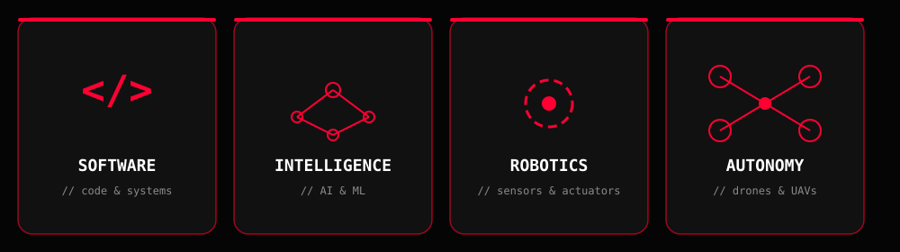

<div align="center">

<!-- HERO BOOT ANIMATION -->


<br>

<!-- TYPING WELCOME -->
<a href="https://github.com/SourabhSRS">
  
</a>

<br>



<br><br>

<!-- STATUS PILLS -->


<br><br>


### `COMPUTER SCIENCE // AI // ROBOTICS // DRONES`

</div>

---

<!-- ==================== SYSTEM PROFILE ==================== -->
<div align="center">

</div>

<br>

<table width="100%">
<tr>
<td width="55%" valign="top">

### `> WHOAMI // SOURABH SRS`
`CSE STUDENT` · `AI EXPLORER` · `ROBOTICS BUILDER`

I'm a **Computer Science Engineering** student building my foundation across **software development, AI, robotics, and drone technology**.

I prefer learning by making things: writing code, experimenting, breaking systems, fixing them, and gradually turning ideas into working physical and autonomous projects.

<details open>
<summary><b>✨ Click to Open // Visitor Welcome & Quick Navigation</b></summary>
<br>
<blockquote>
  👋 <b>Hey there! Glad you dropped by.</b><br>
  • Check out my <b>Tech Arsenal</b> & <b>Robotics Core</b> below.<br>
  • Click any bay in the <b>Active Lab</b> section to expand project specs.<br>
  • Always open to collaborating on <b>AI, Computer Vision, Robotics, and UAVs</b>!
</blockquote>
</details>

</td>
<td width="45%" valign="top">

```yaml
# TELEMETRY :: CORE INTERESTS
AI & ML          : ████████████████████ 95%
SOFTWARE ENG     : ████████████████████ 95%
ROBOTICS         : ███████████████████░ 90%
DRONE SYSTEMS    : █████████████████░░░ 85%
AUTONOMOUS TECH  : ████████████████░░░░ 80%
```

</td>
</tr>
</table>

---

<!-- ==================== TECH ARSENAL ==================== -->
<div align="center">


### `// LANGUAGES & FRAMEWORKS`

<p align="center">
  <a href="https://www.python.org/"></a>&nbsp;
  <a href="https://isocpp.org/"></a>&nbsp;
  <a href="https://www.java.com/"></a>&nbsp;
  <a href="https://developer.mozilla.org/en-US/docs/Web/JavaScript"></a>&nbsp;
  <a href="https://developer.mozilla.org/en-US/docs/Web/HTML"></a>&nbsp;
  <a href="https://developer.mozilla.org/en-US/docs/Web/CSS"></a>&nbsp;
  <a href="https://www.gnu.org/software/bash/"></a>&nbsp;
  <a href="https://www.c-language.org/"></a>&nbsp;
  <a href="https://flask.palletsprojects.com/"></a>&nbsp;
  <a href="https://fastapi.tiangolo.com/"></a>
</p>

### `// AI, VISION & DATA`

<p align="center">
  <a href="https://pytorch.org/"></a>&nbsp;
  <a href="https://www.tensorflow.org/"></a>&nbsp;
  <a href="https://opencv.org/"></a>&nbsp;
  <a href="https://scikit-learn.org/"></a>&nbsp;
  <a href="https://numpy.org/"></a>&nbsp;
  <a href="https://pandas.pydata.org/"></a>&nbsp;
  <a href="https://jupyter.org/"></a>
</p>

### `// ROBOTICS, EMBEDDED & SYSTEMS`

<p align="center">
  <a href="https://www.ros.org/"></a>&nbsp;
  <a href="https://www.arduino.cc/"></a>&nbsp;
  <a href="https://www.raspberrypi.com/"></a>&nbsp;
  <a href="https://cmake.org/"></a>&nbsp;
  <a href="https://www.linux.org/"></a>&nbsp;
  <a href="https://www.docker.com/"></a>
</p>

### `// TOOLS`

<p align="center">
  <a href="https://git-scm.com/"></a>&nbsp;
  <a href="https://github.com/"></a>&nbsp;
  <a href="https://code.visualstudio.com/"></a>&nbsp;
  <a href="https://vim.org/"></a>
</p>

<br>

| CORE | TECHNOLOGY | STATUS |
|:---|:---|:---:|
| `LANGUAGES` |     | `CORE` |
| `WEB & UI` |    | `ACTIVE` |
| `TOOLS` |    | `DAILY` |
| `SYSTEMS` |   | `READY` |
| `EXPLORING` |     | `R&D` |

</div>

---

<!-- ==================== ROBOTICS CORE ==================== -->
<div align="center">




<br><br>

`SOFTWARE`　╱　`INTELLIGENCE`　╱　`ROBOTICS`　╱　`AUTONOMY`

<br><br>

**Areas I'm exploring**

`Artificial Intelligence` · `Machine Learning` · `Computer Vision` · `Robotics` · `Automation` · `Drone Technology`

</div>

---

<!-- ==================== ACTIVE LAB ==================== -->
<div align="center">

</div>

<div align="center">
  <sub><i>⚡ Click on any lab bay below to open up specifications and stack details</i></sub>
</div>

<br>

<details open>
<summary><b><code>01 // AI SYSTEMS</code></b> — <i>Intelligent Agents, Automation & ML Experiments</i></summary>
<br>
<blockquote>
  Small experiments for learning Python, AI concepts, automation and intelligent systems.<br><br>
  <b>Stack:</b> <code>Python</code> · <code>PyTorch</code> · <code>scikit-learn</code>
</blockquote>
</details>

<details open>
<summary><b><code>02 // ROBOTICS</code></b> — <i>Sensors, Control Loops & Physical Machines</i></summary>
<br>
<blockquote>
  Exploring how software can interact with sensors, machines and physical systems.<br><br>
  <b>Stack:</b> <code>Python</code> · <code>C++</code> · <code>ROS</code> · <code>Arduino</code>
</blockquote>
</details>

<details>
<summary><b><code>03 // DRONE INTELLIGENCE</code></b> — <i>Autonomous UAV Navigation & Aerial Vision</i></summary>
<br>
<blockquote>
  Long-term exploration of software, AI and autonomous drone systems.<br><br>
  <b>Stack:</b> <code>Python</code> · <code>C++</code> · <code>OpenCV</code> · <code>Computer Vision</code>
</blockquote>
</details>

<details>
<summary><b><code>04 // SOFTWARE LAB</code></b> — <i>Core Engineering & Systems Fundamentals</i></summary>
<br>
<blockquote>
  Programming projects used to strengthen engineering fundamentals.<br><br>
  <b>Stack:</b> <code>Java</code> · <code>Python</code> · <code>C++</code> · <code>JavaScript</code>
</blockquote>
</details>

---

<!-- ==================== CURRENT MISSION ==================== -->
<div align="center">

</div>

```yaml
SRS_CORE:

  status: "ONLINE"

  learning:
    - Python
    - Java
    - C++
    - Data Structures
    - Artificial Intelligence
    - Machine Learning
    - Git / GitHub

  building:
    - Software Projects
    - AI Experiments
    - Robotics Experiments
    - Drone Concepts

  exploring:
    - Computer Vision
    - Autonomous Systems
    - Intelligent Robotics

  objective:
    "Turn ideas into working systems."
```

---

<!-- ==================== LIVE TELEMETRY ==================== -->
<div align="center">


<details open>
<summary><b><code>// LIVE GITHUB TELEMETRY (CLICK TO TOGGLE)</code></b></summary>
<br>


<br><br>


</details>
</div>

---

<!-- ==================== BUILD PROTOCOL ==================== -->
<div align="center">


<br>

`LEARN` → `BUILD` → `TEST` → `BREAK` → `FIX` → `IMPROVE`

<br>

**REPEAT.**

</div>

---

<!-- ==================== CONNECT ==================== -->
<div align="center">

</div>

<div align="center">

<a href="https://github.com/SourabhSRS">

</a>&nbsp;&nbsp;
<a href="mailto:sourabhrshetty@outlook.com">

</a>&nbsp;&nbsp;
<a href="https://www.linkedin.com/in/sourabh-r-shetty/">

</a>

<br><br>

`SYSTEM ONLINE` · `SOURABH SRS` · `BUILD MODE`

</div>

---

<div align="center">


### `CODE // AI // ROBOTICS // DRONES`

</div>
